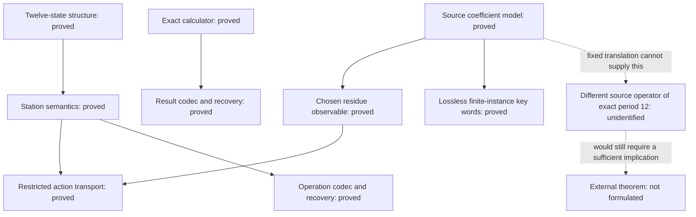

# Proof dependency map and next obligation

Evidence baseline: commit `08d2715a6e73e03374794d9e20522728c46e50d3`,
211 checked theorem declarations. This map adds no mathematical assumptions or
new Lean theorems. Node labels below describe research obligations; they are
not declaration names. The exact machine dependency inventory remains
[THEOREMS.md](THEOREMS.md) and [axioms-and-proofs.txt](axioms-and-proofs.txt).

## What the supplied materials actually claim

The supplied structural ledger states P1–P7: finite-ring decomposition,
symmetries, an antipodal involution, difference/distance invariance, conditions
for reversible encoding, conditions for error correction, and affine
permutations. These are now formalized. Its explicit boundaries say that they
do not establish a historical-text interpretation or imply the Riemann
hypothesis or Unique Games Conjecture. It supplies no theorem deriving a
Millennium Prize result from those seven statements.

The supplied bridge specification proposes a comparison between binary exact-key
folding and modular stations. It explicitly classifies the broad correspondence
as an analogy, while giving a restricted additive map to test. Its historical
inventory of predecessor declarations is not an inventory of this independent
checkout; no predecessor source was consulted for this map.

The supplied HTML defines an arithmetic calculator and makes stronger
interpretive assertions about astronomical assignments. Its arithmetic is now
modeled, but those assertions do not follow from the computed examples.

Accordingly, there is no single stated central theorem in these materials to
which all 211 results are premises. The main proposed connection we can make
precise is the **source-operation-to-station correspondence**. The table below
separates its proved restricted version from stronger versions.

Current finite-instance extension: [operator and key codec](KEY_DIRECTIVES.md).
The 211-theorem baseline below is retained as provenance; the extension adds
34 checked statements. It constructs a coordinate cycle without identifying
that cycle in the external paper.

Product extension: [REGISTER_BRIDGE.md](REGISTER_BRIDGE.md) proves product
operator periods and exact representation transport to a defined modular
relative-phase comparator. This discharges an initial typed bridge obligation;
it does not supply the still-unspecified external theorem implication L.

Canonical extension: [CANONICAL_ENVELOPE.md](CANONICAL_ENVELOPE.md) unifies
finite-index naturality and the defined register/channel envelope. Phase
projection is proved noninjective; full-state retention is kept explicit.

## Claims, prerequisites, and evidence

| Node | Precise content | Required inputs | Status and evidence |
| --- | --- | --- | --- |
| A: twelve-state structure | CRT decomposition, 24 cyclic isometries, 48 affine permutations | Explicit `ZMod 12` state space and cyclic distance | Proved: `twelveCRT_bijective`, `cyclic_station_isometry_card`, `affine_station_group_card`; see [ledger correspondence](STRUCTURAL_LEDGER.md). |
| B: source coefficient model | Reduction factorization, uniqueness, permitted-projection compatibility, exact-key folding | Fixed occurrence data, binary coefficient spaces, specified complement splitting | Proved in the stated model: `source_reduction_factorization`, `source_reduction_unique`, `permitted_pullback_exact_key`, `source_folding`; see [source scope](SOURCE_MODEL.md). |
| C: restricted residue observable | `R(translateKey h q) = R(q) + bridgeTwelve χ h` | B's keys, an explicitly chosen additive functional χ and vertex labeling | Proved: `residue_folding_twelve`. The translation image is contained in `{0,6}`; see `image_in_two_stations`. |
| D: station operation semantics | Every grammar expression denotes a permutation; its compiled affine parameters determine its whole meaning | Explicit `StationExpr` constructors and semantics | Proved: `station_compile_correct`, `station_meaning_iff_compiled`. |
| E: restricted source-to-grammar action | Applying the grammar shift for χ,h to R(q) equals R(translateKey h q) | C and the grammar shift interpretation in D | Proved: `source_shift_observable_equivariance`. This transports the chosen observable, not the entire key. |
| F: exact/robust operation codec | Decode an encoded semantic class exactly; recover it after at most one substitution per triple | D's semantics and the specified repetition channel | Proved: `station_meaning_decode_encode`, `protected_station_semantic_recovery`. |
| G: calculator arithmetic | Exact positive-rational pipeline equals its normalized implementation | Positive numerator/denominator and a natural harmonic | Proved: `cipher_pipeline_correct`; source mapping in [calculator scope](CIPHER_VALIDATOR.md). |
| H: protected calculator result | Recover G's residue after at most one substitution per digit triple | G and the separate result-payload codec | Proved: `cipher_pipeline_protected_recovery`. It does not recover the period. |
| I: fixed binary fold as a one-station rotation | For a fixed binary h and nonempty key carrier, `f(translateKey h q) = f(q)+1` for every q | An unrestricted observable f with this preservation equation | Impossible: the source operation squares to identity, while the target shift by 1 does not. See the derivation below. |
| J: some other genuine source operator has exact period 12 | Identify a source-defined T and prove its twelve iterates return, with no shorter positive period, together with a compatible station map | A different explicitly sourced operator, its carrier, and a preservation equation | Unresolved: no such source operator is identified in the examined material. A's local rotation does not supply it. |
| J-model: chosen coordinate cycle | Coordinate shift on a twelve-coordinate binary complement has exact operator period 12, distinct from every binary intercept translation | Explicit finite carrier in `SourceKeyRepresentation` | Proved: `key_cycle_period_iff`, `key_cycle_distinct_from_translation`. This is not external-source identification J. |
| K: lossless source-key representation | Encode complete keys into structured twelve-symbol words with a decoding left inverse and a compatible translated-word operation | Explicit encodings of metadata and both intercept components, framing, decoder | Proved for metadata `Fin 3`, binary intercept dimension 2 and complement dimension 12: `exact_key_decode_encode`, `exact_key_parse_sound`, `exact_key_word_translation`. C and E remain lossy observables. |
| L-initial: typed modular bridge | Exact word iterations decode to the structural iterations; regular phase initial states preserve external relative-phase equivalence | Known register count; defined state transform; explicitly constructed regular initial state | Proved: `register_transport_iterate`, `register_word_modular_bridge_phase`. Full-key equality is stronger than the comparator. |
| M: canonical finite substrate | Exact full-state/coefficient views and natural transformations under register reindexing | Defined register family; source coefficient maps retain their own types | Proved: `canonical_decode_encode`, `canonical_coefficient_roundtrip`, `canonical_cycle_injective`. Phase projection alone is noninjective. |
| N: defined operational envelope | Master invariant, station action, aligned triple-noise recovery and inverse-dynamics recovery | Known transformation, register count and alignment; at most one substitution per triple; phase regularity for phase laws | Proved: `canonical_master_induction`, `canonical_operational_envelope`, `canonical_initial_recovery`. No broader intelligence claim is formulated. |
| O: validated program composition | Arbitrary finite station programs followed by the bounded channel recover the exact initial canonical state | Grammar-validated operations, known inverse parameters, aligned bounded triple noise | Proved: `pipeline_master_composition`, `pipeline_transmission_injective`. No phase-regularity premise is needed for exact recovery. |
| P: executable package guard | Default Lean build compiles the synthesis, fixtures and native launcher; runner propagates failures | Pinned toolchain and built repository | `lake exe verifyPipeline` runs thirteen boundary checks. See `PIPELINE_DEPLOYMENT.md` and execution log. |
| L: stronger mathematical conclusion | A named external theorem follows from specified source/model properties | Its exact statement, source/model equivalence, and a sufficient implication | Not formulated or proved here. Neither modular closure nor the calculator's zero remainder supplies this implication. |

## Established connections and missing connections

Arrows summarize mathematical prerequisites, not Lean import edges. In
particular, there is no established arrow from G or H to J or L, and no arrow
from error correction to truth of an interpretation.

## First missing implication: examine the operator before assuming a cycle

A candidate correspondence must first name a source carrier Q, a source
operation T, an observable f, and a preservation equation. For the fixed
binary translation already present in the source model, put

`T(q) = translateKey h q`, with `h+h=0`.

The existing `translateKey_add` and `translateKey_zero` give `T(T(q))=q`.
If one additionally asserted `f(T(q))=f(q)+1` in `ZMod 12`, applying that
assertion twice would give

`f(q) = f(T(T(q))) = f(q)+2`.

Cancellation would force `2=0` in `ZMod 12`, which is false. Thus this candidate
fails even without assuming that f is injective or surjective. This paragraph
is a mathematical derivation from checked results, not an additional separately
compiled Lean declaration. The existing checked theorem
`binary_map_not_surjective_twelve` independently rules out every surjective
additive bridge from an exponent-two source. These are specific obstructions;
they do not rule out all possible source structures or comparisons.

For the actually proved observable, the increment is `bridgeTwelve χ h`,
which is 0 or 6. Its period is therefore at most two, consistently with the
source translation. A global observable can take other labels on different
orbits through its supplied vertex labeling; the two-element restriction is
on translation increments and on each fixed orbit, not on all labels globally.

The first unresolved implication on the stronger twelve-cycle branch is
therefore J: **identify a different operator in the source and prove its
period and preservation law**. Assuming twelve levels in
`conditional_level_return` does not discharge that obligation. Reinterpreting
the same fixed binary translation as a twelve-step rotation cannot discharge it.

## Finite-instance continuation now completed

The ledger's structured-sequence route supplies construction K, now completed
for the explicitly chosen finite carrier in [KEY_DIRECTIVES.md](KEY_DIRECTIVES.md). This preserves more
source information without claiming an exact twelve-cycle in the source.

1. The finite dimensions and metadata encodings are fixed explicitly. Both
   intercept components have supplied encodings.
2. The framed word encoder and partial decoder have types `E : ExactKey M K W → List (ZMod 12)` and a
   total partial decoder `D : List (ZMod 12) → Option (ExactKey M K W)`.
3. `D(E(q)) = some q` is proved for every key. Malformed framing is rejected;
   all metadata and both intercept components are recovered.
4. The translated-word operation U_h satisfies the proved identities
   `U_h(E(q)) = E(translateKey h q)` and two-step return on valid words.
5. If robustness is needed, state a framed-word error model and prove its
   recovery bound. Existing fixed-triple guarantees do not cover insertion,
   deletion, or framing loss automatically.

The left-inverse and source-action transport proofs are compiled for this finite
instance. Generic metadata encodings and noisy framing remain beyond it.
This establishes reversible representation for these keys; it does not prove
external-source operator identification J or external theorem implication L.

## Research end point and prize assessment

The supplied materials do not identify an exact Millennium Problem statement
proved by these constructions. Unique Games and P versus NP are different
statements; a local model of part of a Unique Games construction is not a
proof of either. A prize assessment requires first specifying an eligible
problem and completing a proof of its actual statement, followed by applicable
publication and independent-review requirements. No prize eligibility conclusion
is inferred from theorem counts or successful CI.

Sources: [structural ledger correspondence](STRUCTURAL_LEDGER.md),
[binary bridge and archive provenance](BRIDGE_SCOPE.md),
[pinned source model](SOURCE_MODEL.md),
[station semantics](STATION_CODEC.md), and
[calculator provenance and scope](CIPHER_VALIDATOR.md).
